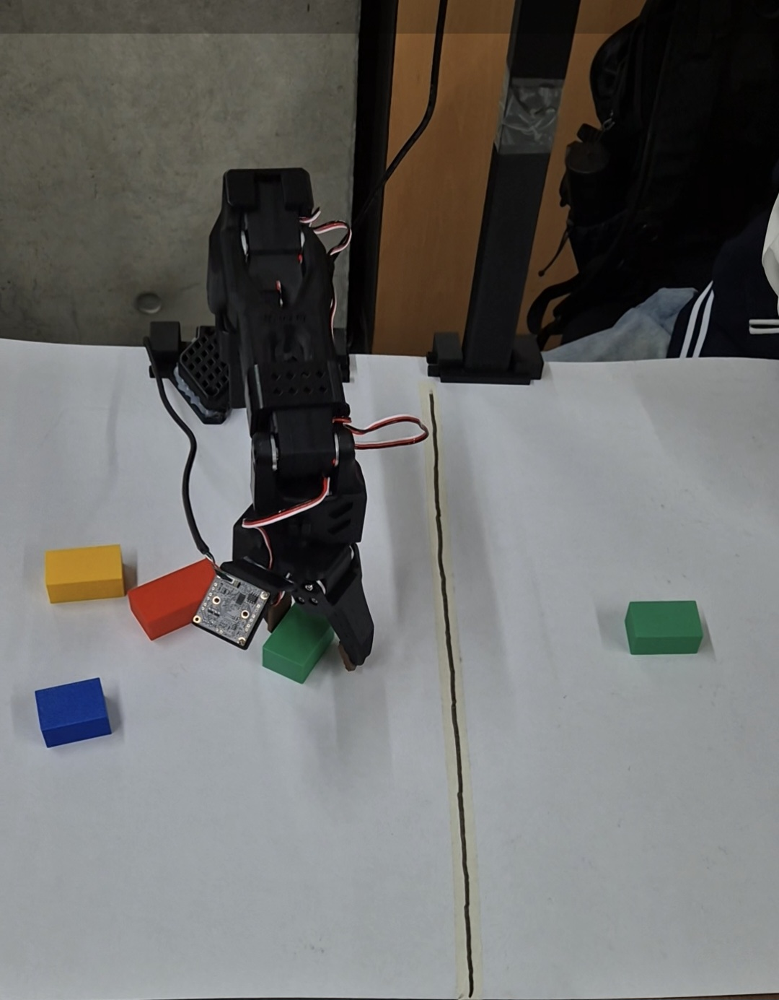
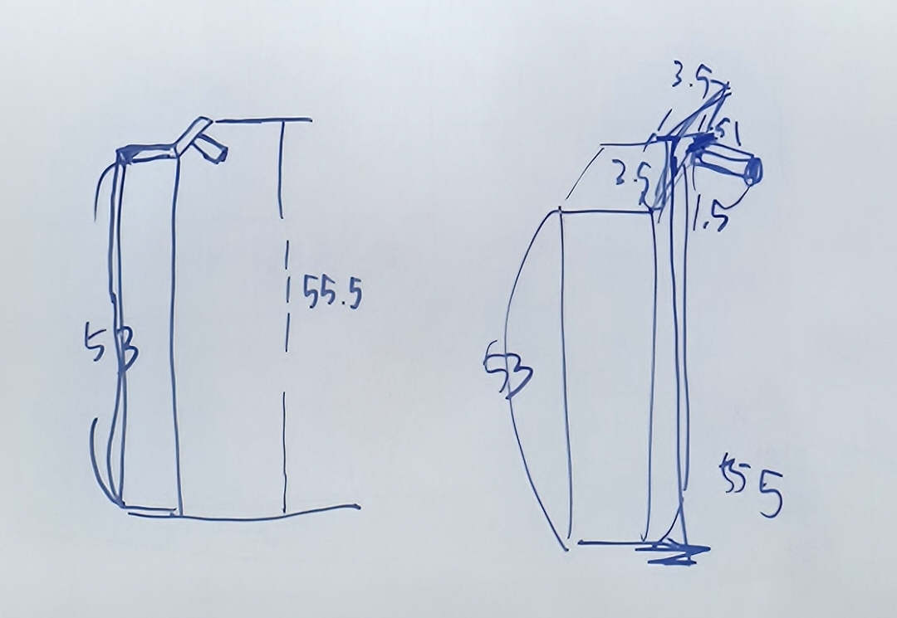
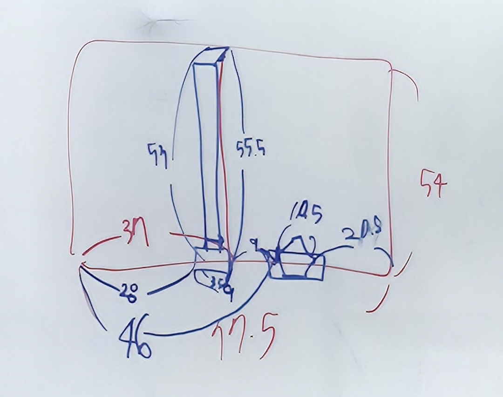

# SOARM-101 Block Building

> Goal: VLA model을 fine-tuning하여 Soarm-101 로봇팔로 주어진 블록과 동일한 형태의 블록을 쌓기



## HW Config

- 카메라: 640×480, 30 FPS 2개 (top view, gripper view)
- 로봇팔: Soarm-101
- 학습 GPU: 1 NVIDIA-RTX 4080 (VRAM 16GB)

## Environment Config

### Blocks

- Red: 가로 6cm, 세로 3cm, 높이 2cm
- Yellow: 가로 5cm, 세로 3cm, 높이 2cm
- Green: 가로 4.5cm, 세로 3cm, 높이 2cm
- Blue: 가로 4cm, 세로 3cm, 높이 2cm

### Cameras

#### Top-view



- 30 FPS
- 640x480

#### Gripper view camera

- 30 FPS
- 640x480

### Board Config



- 좌표 기준: 왼쪽 아래 구석을 (0, 0)으로 가정.
- 보드 규격: 가로 77.5cm, 세로 54cm
- soarm-101 위치: (46, 0) ~ (57.5, 0)
- top-view cam 위치: (28, 0) ~ (37, 0)

### MuJoCo 환경 열기

```powershell
.\.venv\Scripts\python.exe scripts\board_env.py
```

탑뷰 카메라 시점으로 열려면 명령 끝에 `--camera top`을 붙인다.

보드 도면의 좌표계에서 흰 도화지의 검은 중앙선은 `x = 38.75 cm`에 있다. 뷰어와 5회 파일럿에서는 왼쪽 정답 블록 중심을 x 31.4\~34.5 cm, y 14.5\~18.5 cm, 오른쪽 후보 중심을 x 43.4\~48.5 cm, y 15.5\~20.5 cm에서 무작위로 뽑는다. 480회 수집에는 더 넓은 범위를 사용한다. 오른쪽 후보는 움직일 수 있는 강체이며 중앙선은 충돌에 영향을 주지 않는다. [480회 수집의 배치 범위](docs/data/1color/README.md)

탑뷰 거치대는 도면의 53 cm 기둥과 약 55.5 cm 상단 높이를 기준으로 구성했다. 기판·받침판은 옆에서 보았을 때 수평에서 약 34° 기울고, 렌즈 광축은 보드 안쪽을 향해 수평 아래 56°를 이룬다. 화면의 가로축은 보드의 가로변과 평행하다. 실물처럼 보드 아래쪽이 조금 잘리도록 수직 화각을 76°로 잡았다. 640×480 영상에서 카메라 쪽 가장자리 약 0.7 cm가 화면 밖에 있다. 거치대 발판의 앞쪽 끝은 보드 가장자리에서 1.1 cm 뒤에 있다. 거치대 간격, 화각, 잘리는 폭은 파일럿 설정이다.

그리퍼 렌즈는 `gripperframe` 로컬 좌표 `(-8, -6, +2) cm`에서 집게 끝을 향한다. 광축은 집게 길이축(`+X`)과 25°를 이룬다. 이 값은 사진과 비슷한 SO-101 일체형 마운트의 공개 STL에서 얻은 시뮬레이션 초기값이며, 실물 장착각은 미측정이다. 렌즈 위치와 그리퍼뷰 수직 화각(54°), 블록 초기 좌표와 선 폭(2 mm)도 파일럿 설정이다. 보드와 블록 배치는 `scenes/board.xml`, 그리퍼 장착 위치는 `scripts/board_env.py`에서 조정한다. [공개 마운트 STL](https://github.com/TheRobotStudio/SO-ARM100/blob/a758567c3978dfeefe282ede0500085a48fe8f78/Optional/Wrist_Cam_Mount_32x32_UVC_Module/stl/Wrist_Cam_Mount_32x32_UVC_Module_SO101.stl)

## Model

[SmolVLA-base](https://arxiv.org/abs/2506.01844)

## Training Recipe

- [ ] 데이터 수집
- [ ] SmlVLA의 action expert만 fine-tuning. 나머지 가중치는 frozen.
- [ ] 5K step마다 checkpoint를 저장하고, 마지막 5개 checkpoint를 실제 환경에서 evaluation. success rate를 주로 관찰
- [ ] 실패 원인 분석, 다시 데이터 수집 또는 fine-tuning부터 시작.

### Data Collection

[오른쪽 후보 1개 수집 규칙과 실행 방법](docs/data/1color/README.md)에는 총 480개의 색 조합별 할당, 균등한 위치 배치, 놓기 후 초기 자세 복귀 조건을 정리했다.

- lerobot 3rd party library [so101-sim2real](https://github.com/isaka1022/so101-sim2real) 사용.
- MuJoCo 환경에서 Inverse Kinematics를 활용해 데이터 수집
- 접근, 집기, 이동, 놓기 지점마다 집게 중심의 목표 위치를 SO-101 라이브러리의 IK로 풀고, 목표 관절각과 집게 각도를 보간해 6차원 액션으로 기록한다.

프로젝트 루트에서 아래 명령을 실행하면 색 일치 3회와 불일치 2회를 번갈아 수집한다. `--seed`로 배치를 재현할 수 있다. 결과는 `outputs/pilot/color-match-*/dataset`에, 색 조합과 시작·종료 위치 및 검증 수치는 같은 실행 폴더의 `episodes.json`에 저장한다.

```powershell
.\.venv\Scripts\python.exe scripts\collect_pilot.py
```

색이 같은 시연은 양쪽 집게가 블록을 잡고 3 cm 이상 들어 올린 뒤, 보드에 내려놓고 손을 떼었을 때 블록 중심이 선에서 3 mm 이내인 경우에 저장한다. 색이 다르면 2초 동안 같은 모터 목표각을 유지하며, 6개 관절의 최대 변화와 블록 이동량을 검사한다. 두 경우 모두 같은 작업 지시문을 사용한다.
- 카메라는 MuJoCo 환경 구현에서 설정.

### 학습 파일럿 재현

현재 이 PC는 데이터 수집에 사용한다. 아래는 별도 Windows 학습 환경과 NVIDIA GPU에서 기존 파일럿을 재현하는 명령이다.

```powershell
$env:Path = (Resolve-Path .venv\Scripts).Path + ';' + $env:Path
.\.venv\Scripts\python.exe scripts\pilot.py
```

학습 파일럿은 위의 색 비교 시연 5개를 새로 수집한다. 매 프레임에는 MuJoCo 탑뷰·그리퍼뷰(각 640×480, 30 FPS)와 제어 직전의 관절각, 그 시점에 적용할 6개 모터의 목표각(`action`)이 들어간다. 관절각과 목표각 단위는 라디안이다.

두 카메라의 640×480 RGB 영상이 그대로 SmolVLA 비전 인코더에 들어간다. 기본 SmolVLA 커넥터는 정사각형 패치 배열을 가정한다. `scripts/smolvla_640.py`는 직사각형 배열을 유지하고 맨 아래의 불완전한 패치 그룹에만 패딩을 더해 기존 투영 가중치를 사용한다. 이 해상도로 후속 학습·추론을 실행할 때도 파일럿과 같이 `enable_640x480()`를 호출한다.

이 샘플로 사전 학습된 `lerobot/smolvla_base`를 배치 1로 한 스텝 학습한다. 첫 실행에는 가중치와 토크나이저를 받기 위한 인터넷 연결이 필요하다. 샘플과 체크포인트는 실행마다 `outputs/pilot/` 아래 새 디렉터리에 저장한다. 블록 쌓기 성공률은 별도 학습 후 실기에서 평가한다.

새 Windows 환경에서는 Python 3.12로 가상환경을 만들고 CUDA용 PyTorch를 먼저 설치한다.

```powershell
python -m venv .venv
.\.venv\Scripts\python.exe -m pip install torch==2.11.0 torchvision==0.26.0 --index-url https://download.pytorch.org/whl/cu128
.\.venv\Scripts\python.exe -m pip install -r requirements.txt
```

동영상 데이터를 TorchCodec으로 읽을 때는 FFmpeg 공유 빌드의 `bin` 디렉터리가 PATH에 있어야 한다. 이 PC에는 FFmpeg 9.0.2의 실행 파일과 DLL을 `.venv\Scripts`에 설치해서 가상환경을 활성화하면 바로 사용할 수 있다. [Windows 공유 빌드](https://github.com/GyanD/codexffmpeg/releases/tag/9.0.2)
